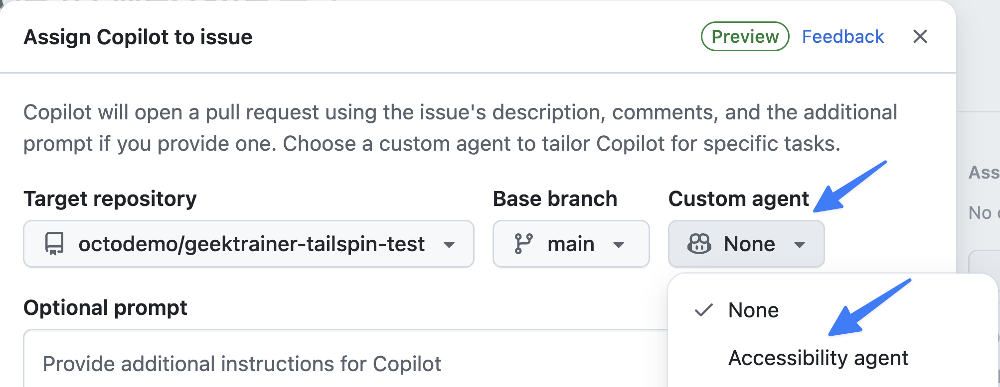

## ¿Qué son los agentes personalizados?

Los [agentes personalizados][custom-agents-concept] de GitHub Copilot permiten crear asistentes de IA especializados para determinadas tareas o áreas del flujo de trabajo de desarrollo. Al definir agentes mediante archivos Markdown en la carpeta `.github/agents` del repositorio, puedes proporcionar a Copilot instrucciones específicas, prácticas recomendadas, patrones de codificación y conocimientos del dominio para que realice mejor ciertos tipos de trabajo. Los equipos pueden codificar sus conocimientos en agentes reutilizables: un agente de accesibilidad que aplique el cumplimiento de [WCAG][wcag], uno de seguridad que siga prácticas de programación segura o uno de pruebas que mantenga patrones de pruebas coherentes.

Los agentes personalizados se definen en archivos Markdown de la carpeta `.github/agents` del proyecto o, de forma global, en `~/.copilot/agents`. Cada archivo tiene un frontmatter YAML con al menos los campos `name` y `description`, seguido de un prompt en Markdown que define el comportamiento, los conocimientos y las instrucciones del agente.

### Diferencias entre los agentes personalizados y las skills de agente

Los agentes personalizados y las [skills de agente][agent-skills-concept] tienen algunos aspectos en común. Ambos se definen principalmente mediante archivos Markdown e indican a una IA cómo realizar ciertas operaciones. La diferencia más sencilla es que el **agente personalizado** es el trabajador y las **skills** son las herramientas.

Los agentes personalizados tienen su propia ventana de contexto y están diseñados para coordinar skills —e incluso otros agentes— mientras realizan su trabajo. En este taller, el agente personalizado de accesibilidad revisará y actualizará el sitio según las pautas de accesibilidad; para ello, podría recurrir a skills como una skill para el flujo de revisión de pull requests o una que ejecute y gestione pruebas.

> [!NOTE]
> No hay una única forma correcta de crear un agente personalizado. Como ocurre con cualquier función de IA, prueba y repite hasta encontrar lo que funciona en tus entornos y escenarios.

[custom-agents-concept]: https://docs.github.com/copilot/concepts/agents/cloud-agent/about-custom-agents
[agent-skills-concept]: https://docs.github.com/copilot/concepts/agents/about-agent-skills
[wcag]: https://www.w3.org/WAI/standards-guidelines/wcag/

En este ejercicio explorarás:

- cómo se definen los agentes personalizados.
- cómo asignar una tarea a un agente personalizado.

## Escenario

Tailspin Toys se compromete a que todas las personas puedan utilizar su plataforma de financiación colectiva, independientemente de sus capacidades o preferencias visuales. Los comentarios recientes han indicado que algunas personas tienen dificultades para leer el tema oscuro actual debido al bajo contraste entre el texto y el fondo. Para abordar este problema de accesibilidad, el equipo de diseño ha solicitado un modo de alto contraste que se pueda activar y desactivar.

La accesibilidad es importante, así que quieres implementar esta función cuanto antes. Para generarla, utilizarás un agente personalizado.

## Revisa el agente personalizado de accesibilidad

Ya se ha creado un agente personalizado de accesibilidad. Revisemos su contenido para entender cómo orientará a Copilot.

Vuelve a tu Codespace y revisa el archivo del agente personalizado de accesibilidad:

1. Abre `.github/agents/accessibility.md`.
2. Fíjate en el frontmatter YAML con los campos `name` y `description`.

> [!CAUTION]
> Los campos `name` y `description` del frontmatter son obligatorios para los agentes personalizados.

3. Revisa las secciones siguientes, que destacan:
   - Responsabilidades principales al generar código para un sitio web accesible.
   - Prácticas recomendadas de accesibilidad.
   - Ejemplos de código HTML, CSS y JavaScript.
   - Errores y problemas habituales.

## Crea y asigna una incidencia

Mission control es el centro donde se gestionan todos los agentes del entorno. Puedes asignar tareas a Copilot cloud agent, supervisarlas e incluso redirigir una sesión en curso para orientarla. Empecemos asignando a Copilot la tarea de crear el modo de alto contraste.

1. Ve a tu repositorio.
2. Selecciona la pestaña **Issues**.
3. Selecciona **New issue** para abrir el cuadro de diálogo de una incidencia nueva.
4. Selecciona **Blank issue** para crearla.
5. Escribe `Add high contrast mode to website` en el campo **Title**.
6. Escribe lo siguiente en **Description**:

    ```plaintext
    We need a high contrast mode for the site. There should be a toggle for high contrast which the user can set. It should store the setting in local storage on the browser.
    ```

7. Selecciona **Create** para crear la incidencia.
8. En el lado derecho, selecciona **Assign to Copilot** para abrir el cuadro de asignación.
9. Selecciona **Accessibility agent** en la lista de agentes personalizados.

    

10. Selecciona **Assign**.
11. ¡Copilot empieza a trabajar en segundo plano!

## Resumen y siguientes pasos

En esta lección has explorado los [agentes personalizados][custom-agents] de GitHub Copilot: asistentes especializados para determinadas tareas y áreas. Con ellos, puedes codificar los conocimientos y estándares del equipo en agentes reutilizables que orientan a Copilot para que realice mejor ciertos tipos de trabajo.

Has explorado estos conceptos:

- cómo se definen los agentes personalizados.
- cómo asignar una tarea a un agente personalizado.

Mientras Copilot implementa el modo de alto contraste, puedes [supervisar y orientar la sesión del agente][next-lesson] desde mission control.

## Recursos

- [Acerca de los agentes personalizados][custom-agents]
- [Preparación para utilizar agentes personalizados en una organización][org-custom-agents]
- [Preparación para utilizar agentes personalizados en una empresa][enterprise-custom-agents]

---

| [← Lección anterior: GitHub Copilot cloud agent][previous-lesson] | [Siguiente lección: Supervisar y gestionar agentes →][next-lesson] |
|:--|--:|

[previous-lesson]: ../2-cloud-agent/
[next-lesson]: ../4-managing-agents/
[custom-agents]: https://docs.github.com/copilot/concepts/agents/cloud-agent/about-custom-agents
[org-custom-agents]: https://docs.github.com/copilot/how-tos/administer-copilot/manage-for-organization/prepare-for-custom-agents
[enterprise-custom-agents]: https://docs.github.com/copilot/how-tos/administer-copilot/manage-for-enterprise/manage-agents/prepare-for-custom-agents
